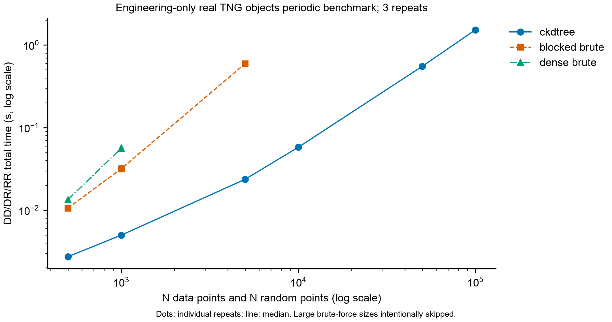

# Benchmarking: pair counting, timing and memory

## Questions and baselines

The benchmark tests whether **periodic cKDTree pair counts** reproduce small-sample reference counts while scaling more effectively than brute-force methods for the chosen distance bins and implementation.

Three methods appear in the historical experiment:

- **cKDTree:** periodic spatial indexing and `DD`, `DR`, `RR` histograms.
- **Blocked brute force:** pair distances computed in bounded blocks; does **not** allocate a full N-by-N distance matrix.
- **Dense brute force:** full-distance-matrix baseline, intentionally restricted to very small samples.

All compared methods use the same input points, periodic box, bins, counting conventions, and random seeds. `DD` and `RR` count unordered distinct pairs; `DR` counts cross-pairs. Counts must match **exactly as integers**, not merely approximately. Excluded large brute-force cases are marked as skipped, **not** treated as validated matches.

## Benchmark workload

The four *scientific* selected catalogues contain **12,281–21,052** objects. Each snapshot was benchmarked at **N=500, 1,000, 5,000, 10,000** (three independent repeats of the formal series). In this benchmarking task **N data points and N random points** are supplied; the science run instead uses `N_R = 5N_D`.

The blocked-brute reference stopped at **N=5,000**; the dense-brute reference stopped at **N=1,000**. The original four-snapshot run recorded **60 method comparisons and 180 DD/DR/RR histogram comparisons** in the valid overlap, matching exactly. Do not claim brute-force equality was measured through 100,000 points.

## Historical 5,000-point results

Three-run median total time for **DD + DR + RR**, in seconds:

| Snapshot | cKDTree | Blocked brute | Baseline / tree |
|---|---:|---:|---:|
| 99 | 0.02386 | 0.59486 | 24.93x |
| 67 | 0.02353 | 0.59597 | 25.33x |
| 50 | 0.02374 | 0.59341 | 25.00x |
| 33 | 0.02359 | 0.59335 | 25.15x |

Even at the smallest *tested* N=500, the tree implementation was faster (approximately 3.83–3.94x across snapshots). The experiment did **not** identify a crossover at smaller N, which remains untested. The numbers are **hardware-, implementation-, and workload-specific** and are not general speed guarantees.

## Independent 100,000-object engineering scaling run

The separate engineering catalogue retained **100,000 real TNG objects** sampled from **106,434 broader-eligibility Snapshot 99 candidates**. It is **not** the high-mass scientific main sample; the 100K series is an engineering scaling measurement only. The 100K cKDTree median total time was **1.5263 seconds**; median whole-worker peak RSS was **96.73 MiB** (three repeats). **No 100K brute-force reference was executed**, and no 100K tree/brute speedup can be reported.



## What was timed and measured

- **Time:** independent worker wall time for both tree builds and `DD`, `DR`, `RR` queries; excludes input-file reading, importing packages, and preparing random samples.
- **Repeats:** three independent worker runs for the reported formal benchmark medians.
- **Memory:** whole-worker **peak RSS**, including interpreter, imports, arrays and calculations, **not** pure incremental algorithm allocation. macOS `resource` RSS unit conventions are not automatically portable to other operating systems.
- **Blocked method:** its block size was 512 in the reported implementation, limiting temporary distance-matrix size. It is incorrect to claim every brute-force variant uses N-squared resident memory.
- **Skipped cases:** the deliberate brute-force size caps protect memory/time and do not demonstrate numerical correctness at those larger sizes.

The published benchmark chart should be read with those omitted points in mind; a line ending before large N does not imply extrapolated measurements.

## Running benchmarks locally

The actual CLI accepts the following arguments (use a **new, non-public output directory** to avoid overwriting previous evidence):

```bash
# Small synthetic reference check, not a published TNG result
python src/benchmark.py --sizes 500 1000 --repeats 1 \
  --output-dir outputs/benchmark_smoke

# Verify real prepared catalogues and benchmark locally after preparation
python src/run_benchmarks.py --root .
```

The second command assumes the expected prepared real-catalogue paths exist and that the Python environment has the required dependencies. The complete historical benchmark should **not** be described as rerun until it is actually executed on the current release copy. The independent engineering catalogue is created through `src/prepare_scaling_catalog.py` with an explicit local `--data-dir` and a separate `--output-dir`.

Keep benchmark raw records and summaries only if their input paths, executable locations, runtime metadata and package provenance have been reviewed and sanitized. Do not publish original whole-machine environment manifests. See [Results](results.md) and [Limitations](limitations.md).
