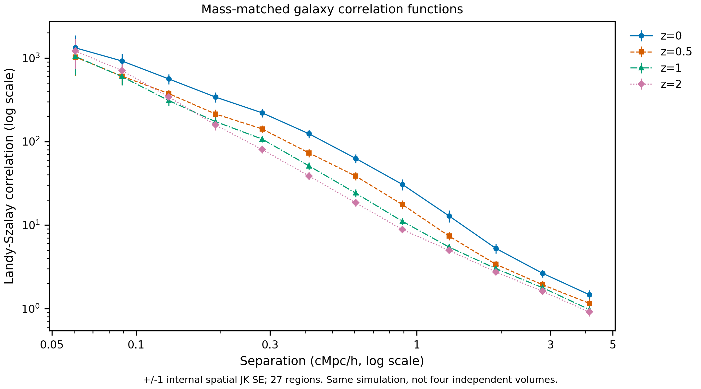
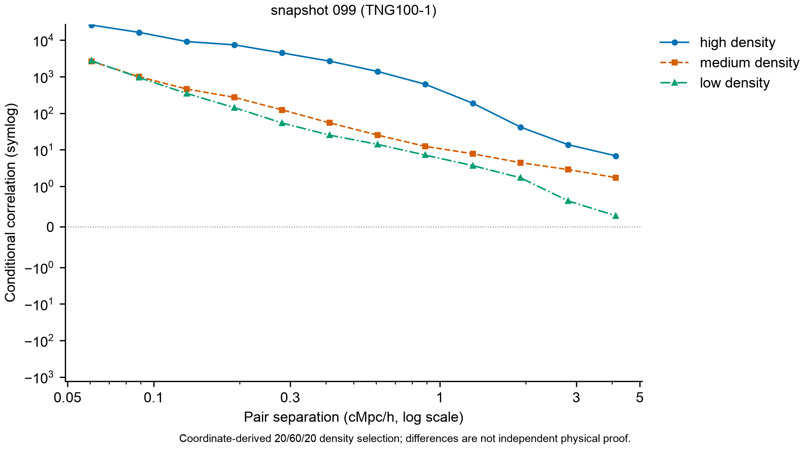
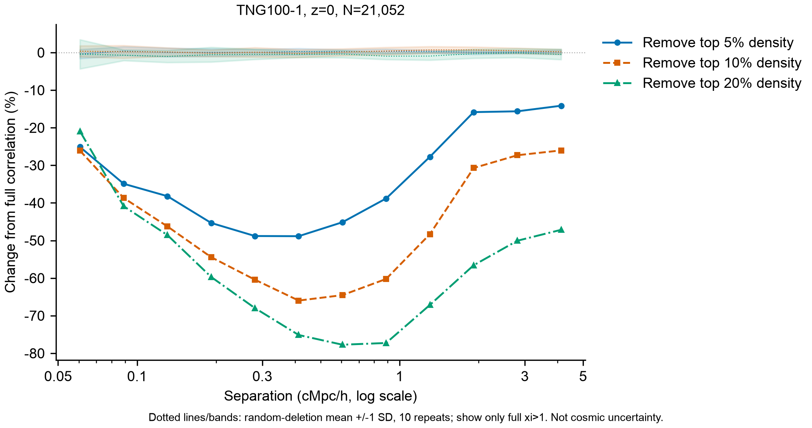
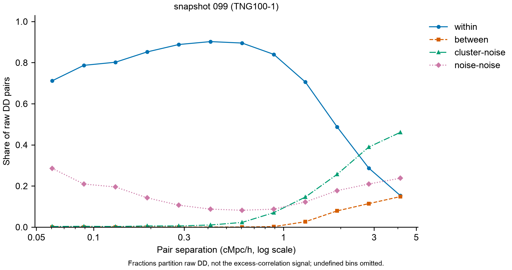
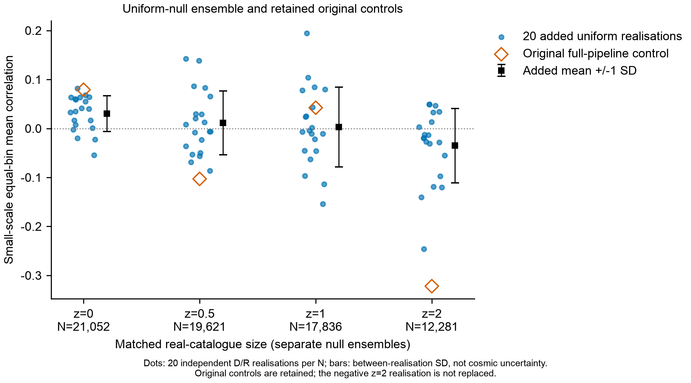
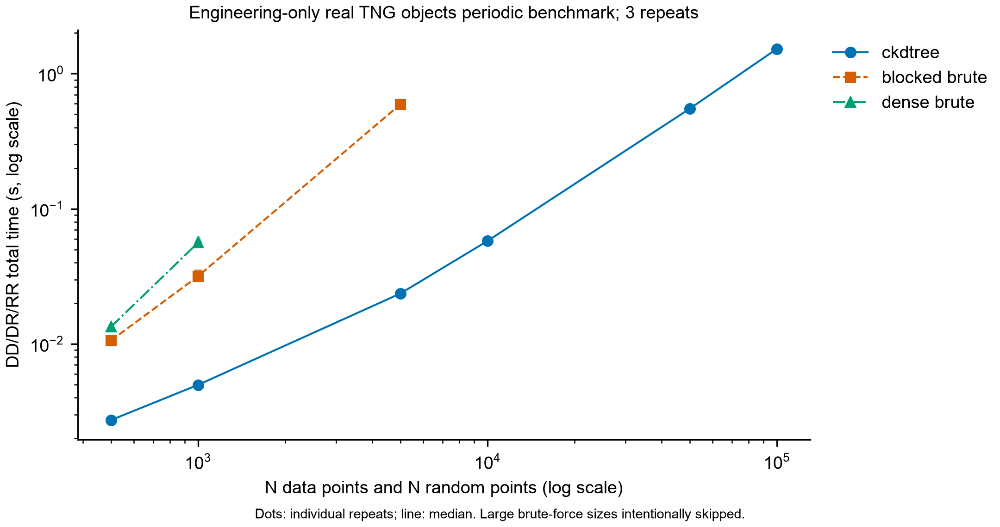

# Results: galaxy spatial statistics and scaling

**Provenance and interpretation.** Numerical values below are transcribed from the **saved 2026-10-21 TNG100-1 experiment and the 2026-10-22 result-versus-proposal review**. They were **not independently regenerated in preparing this GitHub documentation**. The analysis concerns selected simulation catalogues, not observed survey galaxies. Comparisons are descriptive and conditional on the specified catalogue selections, periodic box, seeds, and methods. See [Methodology](methodology.md) and [Limitations](limitations.md).

## Catalogue and global clustering

| Snapshot | Approx. redshift | Main selected objects | Small-scale Landy–Szalay mean ξ ± internal JK SE | Power-law r0 (cMpc/h) | gamma | Reduced chi-squared |
|---|---:|---:|---:|---:|---:|---:|
| 99 | 0 | 21,052 | 141.811 ± 12.928 | 4.414 | 1.968 | 4.865 |
| 67 | 0.5 | 19,621 | 87.411 ± 6.900 | 3.605 | 1.941 | 2.905 |
| 50 | 1 | 17,836 | 64.740 ± 5.681 | 3.353 | 1.865 | 5.470 |
| 33 | 2 | 12,281 | 45.815 ± 4.341 | 3.357 | 1.679 | 3.076 |

“Small-scale mean” is the *equal-weight* mean over three complete bins within the predeclared 0.2–1 cMpc/h interval (actual coverage approximately 0.232–0.734), not a continuous interval integral. The errors are from a 27-region **internal spatial jackknife**, not independent cosmic variance. The correlation declines with separation but remains positive in the most distant measured 3.406–5 cMpc/h bin; the curves were not shown to reach zero in the tested range.

All four nonlinear optimizations converged without reaching parameter bounds. Nevertheless **reduced chi-squared values of 2.905–5.470 indicate imperfect single-power-law descriptions**; `r0` and `gamma` are rough parameterizations rather than evidence of a universally adequate model. The `r0` point estimates are **not strictly monotone** across z≈1 and z≈2.

## Mass-matched cross-redshift comparison

The study additionally matched the same coarse stellar-mass histogram across the four snapshots, giving **12,281 objects per snapshot**. Matching was on coarse bins, not on identical physical galaxies or fully identical within-bin properties.

| Snapshot | Matched N | Small-scale mean ξ ± internal JK SE | Matched r0 (cMpc/h) |
|---|---:|---:|---:|
| 99 | 12,281 | 135.761 ± 14.752 | 4.262 |
| 67 | 12,281 | 84.445 ± 8.018 | 3.328 |
| 50 | 12,281 | 60.769 ± 5.193 | 3.328 |
| 33 | 12,281 | 45.815 ± 4.341 | 3.357 |

The tendency toward stronger reported small-scale clustering at lower redshift persists after coarse mass matching. However these snapshots share **one simulation volume and initial conditions**; do not interpret four time slices as four independent cosmic realizations.

**Figure-label review required:** The supplied PNG is titled “Matched coarse stellar-mass histograms,” but its axes and traces display **Landy–Szalay correlation versus separation**. The original image is retained without alteration here; correct the misleading title by regenerating the plot from reviewed source results before treating the figure as fully publication-ready. It must not be described as a stellar-mass histogram as presently displayed.

## Conditional density and cluster/noise statistics

The coordinate-derived density split is high/medium/low = **20% / 60% / 20%**. Four main-sample small-scale mean ξ values were reported:

| Snapshot | High density | Medium density | Low density | Cluster minus noise |
|---|---:|---:|---:|---:|
| 99 | 2846.33 | 67.77 | 31.09 | 671.08 |
| 67 | 1560.43 | 60.22 | 37.53 | 429.68 |
| 50 | 1050.94 | 54.34 | 43.13 | 327.94 |
| 33 | 649.50 | 46.72 | 54.15 | 174.30 |

High-density subsets are strongest for this statistic, while the **medium/low ordering reverses at z≈2**. That reversal is a point-estimate ordering, not an established statistically significant reverse physical effect. The high-density and cluster/noise contrasts share coordinate-derived labels with the underlying correlation measurement.

The original clustering analysis found 103 / 91 / 75 / 57 HDBSCAN groups in snapshots 99 / 67 / 50 / 33, with noise fractions about 57.7% / 60.4% / 62.3% / 59.2%. Group median density correlated **positively** with compactness and persistence, but **negatively** with mean membership strength for all four snapshots. These quantities should not be conflated as a single “stability” score; sparse-graph clustering is also an approximation.

## Targeted deletion and raw pair composition

Removing the highest-density **10%** reduced the predeclared small-scale mean ξ by the following *ratio-of-means* percentages (the percentage is **not** an average of binwise percentages):

| Snapshot | Relative change on targeted 10% removal | Random 10% removal, mean Δξ ± between-repeat SD | Same-cluster share of raw DD across three small-scale bins |
|---|---:|---:|---:|
| 99 | -62.8% | -0.03 ± 1.52 | 89.62% |
| 67 | -50.3% | 0.25 ± 1.14 | 84.26% |
| 50 | -40.9% | 0.24 ± 0.54 | 78.69% |
| 33 | -31.7% | 0.21 ± 0.64 | 72.21% |

Random-deletion SD describes **10 random deletion repeats**, not spatial-jackknife error or cosmic variance. Targeted deletion also changed the most distant tested bin by about **-25.3% to -27.5%**; it is not correct to say larger-scale measurements were unaffected.

For the smallest bin, **0.05–0.07339 cMpc/h**, same-cluster pairs accounted for approximately **59.2–71.2%** of *raw DD*, while noise–noise pairs still accounted for approximately **28.6–40.0%**. Within the three-bin small-scale aggregate, same-cluster raw DD fractions were **72.2–89.6%**. These fractions are **not** fractions of the Landy–Szalay excess-correlation signal and cannot be used as numerical causal attribution.

## Uniform-null controls and an unresolved calibration issue

The original same-size uniform control for **snapshot 33 (z≈2)** returned a small-scale mean of **-0.322** with internal JK SE approximately **0.081**. That was not discarded. Afterwards, the study added **20 independent seeded D/R realizations for each of the four catalogue sizes**:

| Matched snapshot size | Original control mean ξ | Additional 20-run mean | Between-realization SD |
|---|---:|---:|---:|
| 99 | 0.0791 | 0.0303 | 0.0365 |
| 67 | -0.1030 | 0.0111 | 0.0651 |
| 50 | 0.0424 | 0.0030 | 0.0814 |
| 33 | -0.3220 | -0.0350 | 0.0760 |

The z≈2 original is approximately **3.77 ensemble SD below** the added 20-run mean. A 20-run ensemble cannot reliably calibrate tail probabilities, and some approximate uncertainty intervals for added means do not contain zero. Independent short-distance pair enumeration agreed with saved original `DD`, `DR`, `RR` counts, but that does **not** independently validate the jackknife error model or establish that the negative result was merely a random accident. These checks were **post-hoc** diagnostics, not pretended pre-registered tests.

## Computational scaling summary

On tested 5,000-object reference workloads, periodic cKDTree matched brute-force pair histograms and was about **25x faster** (three-run median total DD/DR/RR timing). The separately selected **100,000-object engineering-only** sample ran in **1.5263 s median** with **96.73 MiB whole-worker peak RSS**; **no 100K brute-force comparison** was run.

See [Benchmarking](benchmarking.md) for exact workload and memory definitions, and [Expected versus observed](expected_vs_observed.md) for which original expectations were supported, qualified, or not tested.
